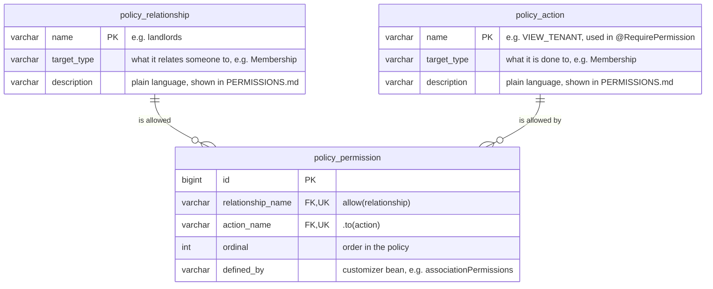

# Spring Boot access control demo: a homeowners' association

A Spring Boot 4 application that shows **relationship-based access control** with Spring Security method
security. Whether you may do something depends on how you relate to the thing, and that relationship can end.
Owners vote and see the member list. Tenants only receive notices. A property manager runs every association
in their district. An accountant may see one owner's dues account.

## Run it

```bash
./mvnw package          # builds and runs the tests
java -jar target/spring-boot-access-control-0.0.1-SNAPSHOT.jar
```

Open <http://localhost:8080> and pick a persona. There is no password, and you can switch personas at any
time. Data lives in memory and is reset on restart.

Most units are rented out by their owner to a tenant. mia lives in her own flat, and Apt 3 has been vacant since
erin moved out:

| Association | Unit | Owner | Tenant |
|---|---|---|---|
| Maple Court (Riverside) | Apt 1 | alice | bob |
| | Apt 2 | frank | kim |
| | Apt 3 | frank | vacant (erin's lease ended) |
| | Apt 4 | mia | — (mia lives there herself) |
| Oak Terrace (Riverside) | No. 7 | grace | heidi |
| Birch Hill (Hillside) | House 2 | judy | leo |

Living in the same unit doesn't mean having the same rights:

| Persona | What they get |
|---|---|
| alice, frank, grace, judy, mia (owners) | notices and owner messages, member list with the names of their own tenants (others only as a count), polls and voting, own dues |
| bob, kim, heidi, leo (tenants) | notices to everyone, to those living here or to tenants, personal messages; no member list, polls or owner's dues |
| carol (property manager, Riverside) | everything in Maple Court and Oak Terrace, sending messages, managing residents and units |
| ivan (property manager, Hillside) | the same for Birch Hill; carol and ivan can't see each other's district |
| dave (Alice's accountant) | Alice's dues account only |
| erin (former tenant) | nothing, until carol reinstates her in Apt 3 |

As carol you can send a message to everyone, to owners only, to everyone living there (tenants and owner-occupiers), to tenants only, or to one resident. On the
*Residents* tab you can make bob an owner, end someone's access or reinstate erin. Then switch persona to see
the effect. The *Access check* tab sends real requests and shows which ones the server allows for the current
persona.

## How it works

**Policy.** Who may do what is defined per feature, in plain role-first rules, for example
[`AssociationRules`](src/main/java/eu/hohenegger/accesscontrol/permission/rules/AssociationRules.java):

```java
@Bean
PolicyCustomizer associationPermissions() {
    return policy -> policy
            .allow(OWNERS).to(VIEW_ASSOCIATION, VIEW_OWNERS, COUNT_TENANTS)
            .allow(TENANTS).to(VIEW_ASSOCIATION)
            .allow(LANDLORDS).to(VIEW_TENANT)
            .allow(DISTRICT_MANAGERS).to(VIEW_ASSOCIATION, VIEW_OWNERS, COUNT_TENANTS, VIEW_TENANT, VIEW_VACANCIES,
                    MANAGE_RESIDENTS);
}
```

Anything not allowed is denied. A relationship only counts while it is active, so an ended lease, sale or
delegation takes effect immediately. The builder produces a JPA model of the policy, which is stored in the
database at startup; the application decides with what was stored. The section [The permission policy](#the-permission-policy) below explains
how to review and extend it.

**Controllers** use a meta-annotation with placeholders (Spring Security's `AnnotationTemplateExpressionDefaults`):

```java
@PostMapping("/polls/{pollId}/votes")
@RequirePermission(action = "VOTE", on = "pollId")
PollView vote(@PathVariable String pollId, @RequestBody Ballot ballot, User me) { ... }
```

**In code**, the same policy is available through a fluent API. It is used for filtering lists and for
field-level decisions, such as which tenants an owner may see by name:

```java
permissions.check(me).may(VIEW_TENANT).filter(association.residents().activeAt(now).tenants().list())
permissions.check(me).may(READ_MESSAGE).filter(community.messages())
```

**Domain.** The demo data is built with the same style
([`DemoData`](src/main/java/eu/hohenegger/accesscontrol/demo/DemoData.java)):

```java
maple.unit("Apt 1").ownedBy(alice).rentedTo(bob);
maple.unit("Apt 3").ownedBy(frank).rentedTo(erin).since(now.minus(400, DAYS)).until(now.minus(30, DAYS));
community.grant(dave).accessToDuesOf(alice).as("Accountant");
community.message().from(carol).toOwnersOf(maple).about("Annual assembly: agenda").saying("...");
```

**Audit log.** All permission-related activity goes to the logger `access`. At `DEBUG` it also logs every
single policy decision.

```
SESSION visitor now acts as bob (Tenant · Maple Court, Apt 1)
DENIED  bob VIEW_OWNERS on Maple Court (not among owners or district managers)
GRANTED dave VIEW_DUES on dues account of alice (Accountant for Alice Andersen)
FILTERED bob READ_MESSAGE: 4 of 7 granted
ADMIN   carol ended bob's access to Maple Court
```

**Tests.** The `@WebMvcTest` tests state, for each endpoint, exactly who may use it. Every other persona is
expected to get `403`, so each line generates one positive or negative test per persona (692 tests in total):

```java
access("read a message to the owners of Maple Court", () -> get("/api/messages/{id}", messageId(ASSEMBLY)))
        .grantedOnlyTo("alice", "carol", "frank");
```

Requests for ids that don't exist are also answered with `403`, not `404`, so the API doesn't reveal what exists.

## The permission policy

The policy is written so that developers can add permissions together with a feature, and domain experts
without programming knowledge can review the result.

### Reading it: `PERMISSIONS.md`

Domain experts don't read Java. They read [`PERMISSIONS.md`](PERMISSIONS.md), which is generated from the
policy. It contains a "who may do what" table and one section per relationship, written only with the
plain-language descriptions of relationships and actions:

```markdown
### Landlords

The owner of the unit a tenant rents. This only relates an owner to their own tenants.

They may:

- see who a tenant is (name and unit)
```

`PermissionsDocumentTest` compares the file with the current policy and fails when they differ. A change to the
rules therefore can't be merged without updating `PERMISSIONS.md`, and every pull request that changes a
permission shows it as a readable diff for the domain expert to approve. Regenerate the file with:

```bash
./mvnw test -Dtest=PermissionsDocumentTest -Dpermissions.update
```

### Writing it: the vocabulary

Rules have the form `allow(RELATIONSHIP).to(ACTION, ...)`.

- **Actions** ([`Action`](src/main/java/eu/hohenegger/accesscontrol/permission/Action.java)) are things someone
  wants to do, typed by what they are done to: `VOTE` is an `Action<Poll>`, `VIEW_TENANT` an `Action<Membership>`.
- **Relationships** ([`Relationships`](src/main/java/eu/hohenegger/accesscontrol/permission/Relationships.java))
  say how someone relates to that thing: `OWNERS`, `TENANTS`, `LANDLORDS`, `DISTRICT_MANAGERS`, `SENDERS`,
  `ADDRESSEES`, `ACCOUNT_HOLDERS`, `DELEGATES`. Each one explains itself, which becomes the reason in the audit log.
- **Every piece of information gets its own action.** Who owns which unit (`VIEW_OWNERS`), how many tenants there
  are (`COUNT_TENANTS`), who a tenant is (`VIEW_TENANT`) and which units are empty (`VIEW_VACANCIES`) are separate
  actions, even though they appear on the same screen. That way the rules say exactly what each relationship gets
  to see, and the controllers return a field only when its action is granted (`null` otherwise). Don't hide extra
  data behind a broad action such as "view members": a reviewer can't see it in the rules or in `PERMISSIONS.md`.
- Relationships to an association, such as `OWNERS` or `DISTRICT_MANAGERS`, work for everything that belongs to an
  association (anything implementing `AssociationScoped`): the association itself, its polls, messages, tenancies
  and the dues accounts of its owners. Other relationships only fit one kind of target, and the compiler enforces
  it: `allow(SENDERS).to(VIEW_DUES)` doesn't compile, because senders relate to messages, not dues accounts.

### Extending it: `PolicyCustomizer` beans

Like Spring Boot's `Jackson2ObjectMapperBuilderCustomizer`, every `PolicyCustomizer` bean contributes to one shared
policy, which [`PolicyConfiguration`](src/main/java/eu/hohenegger/accesscontrol/permission/PolicyConfiguration.java)
builds at startup. Permissions only add up, so the order of the customizers doesn't matter. Each feature has its
own rule class in [`permission/rules`](src/main/java/eu/hohenegger/accesscontrol/permission/rules):
`AssociationRules`, `PollRules`, `MessageRules` and `DuesRules`.

For example, a new feature that lets residents report repairs to a caretaker would add three things.

1. Its actions, each with a description for `PERMISSIONS.md`:

   ```java
   public final class RepairActions {
       public static final Action<Association> REPORT_REPAIR =
               Action.define("REPORT_REPAIR", Association.class, "report something that needs repair");
       public static final Action<Association> VIEW_REPAIRS =
               Action.define("VIEW_REPAIRS", Association.class, "see reported repairs");
   }
   ```

2. A new relationship, if the existing ones don't fit:

   ```java
   public static final Relationship<AssociationScoped> CARETAKERS = Relationship.define("caretakers", AssociationScoped.class,
           "Caretakers currently looking after the association's buildings.",
           (context, target) -> target.associationsAt(context.now())
                   .flatMap(association -> association.caretakerAssignmentOf(context.actor(), context.now()).stream())
                   .findFirst().map(Object::toString));
   ```

3. A customizer bean with its rules:

   ```java
   @Configuration
   public class RepairRules {

       @Bean
       PolicyCustomizer repairPermissions() {
           return policy -> policy
                   .allow(OWNERS).to(REPORT_REPAIR, VIEW_REPAIRS)
                   .allow(TENANTS).to(REPORT_REPAIR)
                   .allow(CARETAKERS).to(VIEW_REPAIRS)
                   .allow(DISTRICT_MANAGERS).to(VIEW_REPAIRS);
       }
   }
   ```

The controller then uses the new action like any other:

```java
@PostMapping("/api/associations/{id}/repairs")
@RequirePermission(action = "REPORT_REPAIR", on = "id")
RepairView report(@PathVariable String id, @RequestBody NewRepair repair, User me) { ... }
```

Then run the tests. `PermissionsDocumentTest` fails until `PERMISSIONS.md` is regenerated, and the regenerated file
shows the new rows and the new "Caretakers" section for review. The new endpoint also gets an access-matrix test
line, such as `access("report a repair in Maple Court", ...).grantedOnlyTo(...)`. `PolicyCustomizerTest` shows a
customizer bean extending the policy in isolation.

`caretakerAssignmentOf` doesn't exist in the demo; the repair feature would add it to the domain together with
its data.

### Storing it: the JPA model

The fluent builder doesn't create the policy directly. It builds a JPA model of it: one `PermissionEntity` per
`allow(...).to(...)` pair, pointing to a `RelationshipEntity` and an `ActionEntity` that hold the names, target
types and plain-language descriptions
([`permission/model`](src/main/java/eu/hohenegger/accesscontrol/permission/model)).

```java
List<PermissionEntity> model = Policy.define()
        .allow(OWNERS).to(VIEW_POLLS, VOTE)
        .allow(DISTRICT_MANAGERS).to(VIEW_POLLS, CREATE_POLL)
        .build();
Policy policy = Policy.of(policyStore.replaceWith(model));
```

At startup [`PolicyConfiguration`](src/main/java/eu/hohenegger/accesscontrol/permission/PolicyConfiguration.java)
runs all `PolicyCustomizer` beans on one builder, and
[`PolicyStore`](src/main/java/eu/hohenegger/accesscontrol/permission/model/PolicyStore.java) replaces the stored
policy with the result and reads it back. The `Policy` bean is created from what was read, so the permissions
the application enforces are exactly the rows in the database. The audit log reports it:

```
POLICY  24 permissions stored: {owners=[VIEW_ASSOCIATION, VIEW_OWNERS, COUNT_TENANTS, VIEW_POLLS, VOTE], ...}
```



Each relationship and action is stored once, however many permissions use it, and a pair can't be stored twice
(unique key on `relationship_name` and `action_name`). `defined_by` records which customizer bean added a
permission, so a reviewer can trace each row back to its feature.

The tables hold the vocabulary and the rules, but not *how* to tell whether a relationship holds: that is code,
such as the landlord check below. `Policy.of(...)` therefore looks each name up among the relationships and
actions defined in code, and refuses to start if a row names an unknown one, or pairs a relationship with an
action on something it can't judge (for example `landlords` with `VIEW_DUES`: landlords relate to tenancies, not
dues accounts). In code the compiler prevents that pairing; for the database, `PolicyStoreTest` tests the check.

The code stays the source of truth. The stored policy is replaced as a whole at every start, so a permission
removed from a customizer also disappears from the database. The demo uses an embedded H2 database; set
`spring.datasource.url` to keep the policy in another database, for example to query it from a reporting tool.

### Example: owners see their own tenant, but not the others

alice rents Apt 1 out to bob, and frank rents Apt 2 out to kim. In the member list, alice should see bob's
name but only a count for kim. The rules in `AssociationRules` say exactly that:

```java
.allow(OWNERS).to(VIEW_ASSOCIATION, VIEW_OWNERS, COUNT_TENANTS)
.allow(LANDLORDS).to(VIEW_TENANT)
```

Read as: owners see who owns which unit and *how many* tenants there are; landlords see *who* a tenant is.

1. **`COUNT_TENANTS`** is checked on the association. All owners have it, so alice gets the number of tenants.
2. **`VIEW_TENANT`** is checked once per tenancy, with that tenancy (bob in Apt 1, kim in Apt 2) as the target,
   not the association. That's why it can be granted for one tenant and denied for another. Only `LANDLORDS`
   and `DISTRICT_MANAGERS` have it, and `LANDLORDS` holds only if the viewer currently owns *the unit that
   tenancy is for*:

   ```java
   tenancy.unit().residents().activeAt(context.now()).owners().of(context.actor())
   ```

[`AssociationController`](src/main/java/eu/hohenegger/accesscontrol/web/AssociationController.java) applies both
checks to the member list (which itself requires `VIEW_OWNERS`):

```java
List<Membership> tenancies = residents.tenants().list();
List<Member> visibleTenants = permissions.check(me).may(VIEW_TENANT).filter(tenancies)...;
return new MemberList(owners, visibleTenants, may(me, COUNT_TENANTS, association) ? tenancies.size() : null);
```

| Viewer | bob (Apt 1) | kim (Apt 2) | Response |
|---|---|---|---|
| alice, owner of Apt 1 | ✔ landlord of Apt 1 | ✘ not her unit | `tenants: [bob], tenantCount: 2` |
| frank, owner of Apt 2 and 3 | ✘ not his unit | ✔ landlord of Apt 2 | `tenants: [kim], tenantCount: 2` |
| mia, lives in Apt 4 | ✘ | ✘ | `tenants: [], tenantCount: 2` |
| carol, property manager | ✔ district manager | ✔ district manager | `tenants: [bob, kim], tenantCount: 2` |
| bob, tenant | — | — | `403`: no `VIEW_OWNERS` |

The audit log shows each decision with its reason (the individual decisions at `DEBUG`):

```
GRANTED alice VIEW_OWNERS on Maple Court (owner in Maple Court, Apt 1)
GRANTED alice VIEW_TENANT on tenant in Maple Court, Apt 1 (landlord of Apt 1 in Maple Court)
DENIED  alice VIEW_TENANT on tenant in Maple Court, Apt 2 (not among landlords or district managers)
FILTERED alice VIEW_TENANT: 1 of 2 granted
```

Because the relationship is checked at the moment of the request, the name disappears as soon as bob's lease ends
or alice sells Apt 1. `ownersSeeTheTenantsOfTheirOwnFlatsByName` in `AssociationAccessTest` tests the table above.

## Design notes

### Demo domain: a university course

An **auditor** attends and sees the material, but isn't on the roster and doesn't hand in work or
vote: a silent participant. An **enrolled student** is the open participant.


#### Demo data

| User | Role | `GET /api/courses` | Roster | Grades of Alice | Poll |
|-------|---|---|---|---|---|
| alice | enrolled in Astronomy 101 | Astronomy 101 | ✔ (auditors shown as a count) | ✔ | ✔ |
| bob | auditor in Astronomy 101 | Astronomy 101 | ✘ | ✘ | ✘ |
| carol | lecturer, physics department | all physics courses | ✔ (with names) | ✔ | — |
| dave | Alice's guardian | — | ✘ | ✔ | ✘ |
| erin | guest lecturer, expired | — | ✘ | ✘ | ✘ |

### Other demo domains considered

| Domain | Fits well | Weaker spot |
|---|---|---|
| **Homeowners' association / community garden** | Members vote, tenants (silent) see notices only | Less familiar internationally; few documents |

#### Homeowners' association: demo data

| User | Role | `GET /api/associations` | Member list | Dues account of Alice | Vote |
|-------|---|---|---|---|---|
| alice | owner-member of Maple Court | Maple Court | ✔ (tenants shown as a count) | ✔ | ✔ |
| bob | tenant in Maple Court | Maple Court | ✘ | ✘ | ✘ |
| carol | property manager, Riverside district | all Riverside associations | ✔ (with names) | ✔ | — |
| dave | Alice's accountant | — | ✘ | ✔ | ✘ |
| erin | former tenant, lease ended | — | ✘ | ✘ | ✘ |
